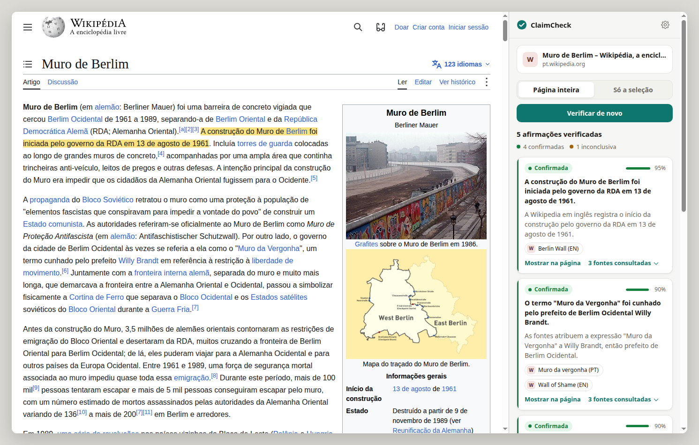
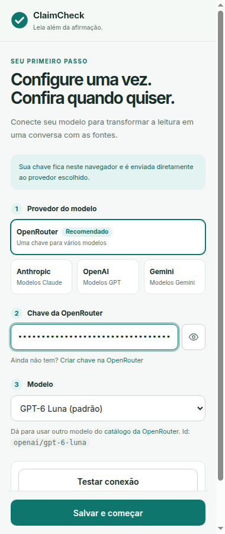
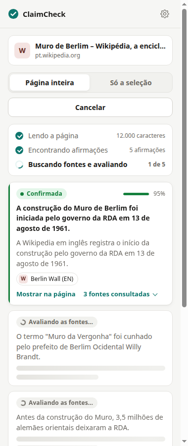
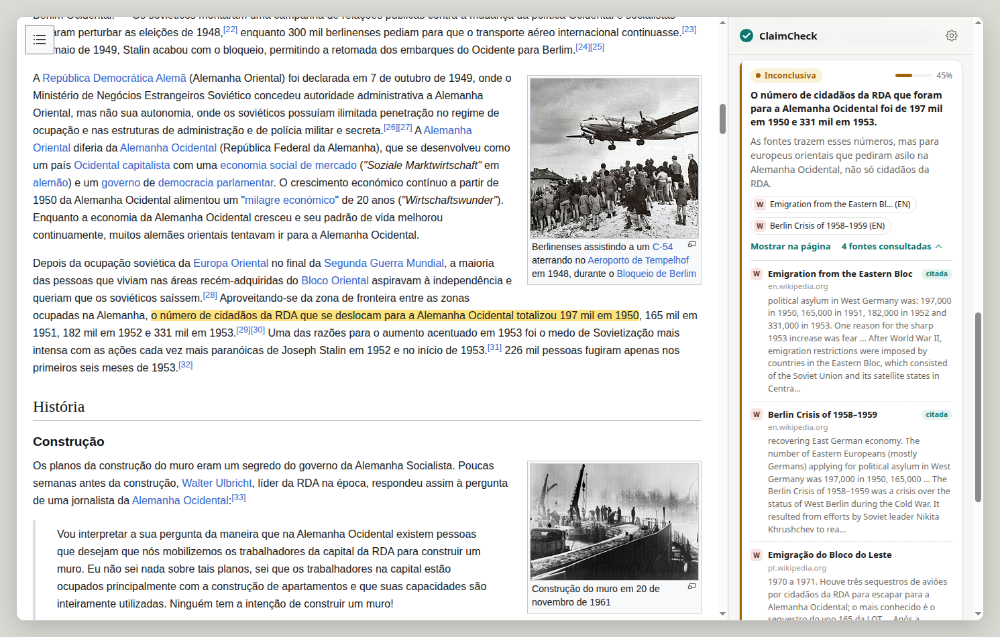
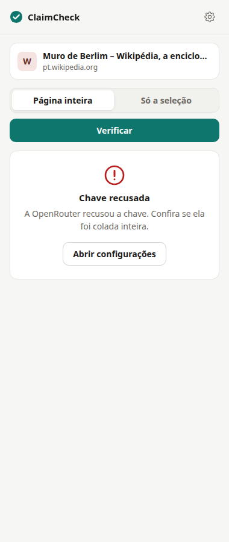
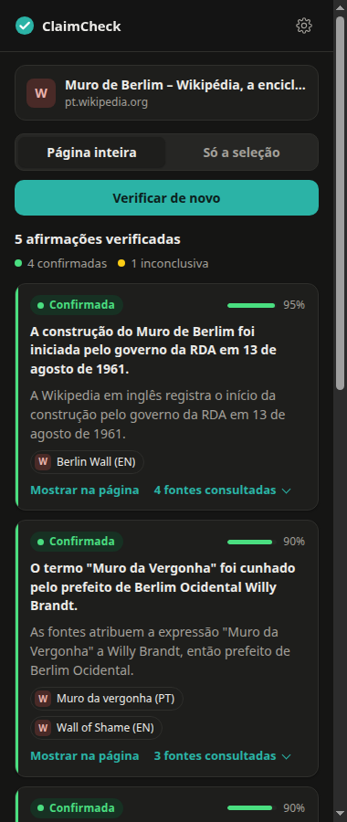

# ClaimCheck

[](https://github.com/ArthurGoon/ClaimCheck/actions/workflows/ci.yml)

Extensão do Chrome que checa as afirmações da página que você está lendo. Você abre o painel lateral, clica em **Verificar** (a página inteira ou só o trecho selecionado) e recebe a lista de afirmações factuais com um veredito (**confirmada**, **refutada** ou **inconclusiva**), a confiança, uma explicação de uma linha e as fontes. Clicando em "Mostrar na página", o trecho da afirmação fica destacado no texto.



<sub>Página e busca reais (Wikipedia, novembro de 2026). As respostas do modelo nesta e nas outras imagens são simuladas: escrevi os vereditos depois de ler as evidências que a busca devolveu, para testar a interface sem chave de API. Detalhes em [Testes](#testes).</sub>

## Instalação

Não tem build. Precisa do Chrome 116 ou mais novo.

1. Clone o repositório.
2. Abra `chrome://extensions`, ative o **Modo do desenvolvedor** e clique em **Carregar sem compactação**.
3. Escolha a pasta do repositório (a que tem o `manifest.json`).
4. Clique no ícone do ClaimCheck. O painel lateral abre direto na configuração.

## Configuração

O ClaimCheck usa um modelo de linguagem com a sua própria chave de API. Não dá para entrar com a conta do ChatGPT ou do Claude: essas assinaturas não têm login aberto para extensões de terceiros, então a chave é o caminho.

O mais simples é a **OpenRouter**: uma chave só dá acesso a modelos de vários provedores e a cobrança é por uso.

1. Crie uma chave em [openrouter.ai/settings/keys](https://openrouter.ai/settings/keys) e coloque créditos na conta.
2. No painel, escolha OpenRouter, cole a chave e clique em **Testar conexão**. O teste faz uma chamada real e curta ao modelo escolhido, usando o mesmo formato de resposta estruturada da verificação.
3. Salve. Pronto.

| Provedor | Modelo padrão | Outros na lista |
|----------|---------------|-----------------|
| OpenRouter (recomendado) | `openai/gpt-6-luna` | Claude Haiku 5.5, Gemini 3.8 Flash, DeepSeek V4.1 Flash, Qwen 3.8 Flash |
| Anthropic | `claude-haiku-5-5` | Claude Sonnet 5.5 |
| OpenAI | `gpt-6-luna` | GPT-6 Luna Pro |
| Gemini | `gemini-3.8-flash` | Gemini 3.5 Flash Lite |

O campo de modelo também aceita qualquer id digitado (por exemplo, qualquer modelo do catálogo da OpenRouter). Se colar uma chave de outro provedor, o painel percebe pelo prefixo e oferece a troca. As chaves ficam em `chrome.storage.local`, só neste navegador, e vão direto para o provedor escolhido.

**Busca de fontes.** A Wikipedia é sempre consultada, pela API oficial, no idioma da página e em inglês. Para cobrir notícias e sites fora da Wikipedia, dá para adicionar uma chave da [Tavily](https://app.tavily.com/) (o plano gratuito tem 1.000 créditos por mês) ou do [Brave Search](https://api-dashboard.search.brave.com/) nas configurações. Se uma busca falhar, o resultado sai com as fontes que responderam e um aviso discreto.

## Como funciona

```
página ─► texto principal (sem menu, rodapé, caixa de informações)
            │
            ▼
         extração (LLM, JSON com schema)
            │  até 5 afirmações (3, 5 ou 8 nas configurações), cada uma com o trecho literal da página e uma consulta de busca
            ▼
         busca de evidências, 3 afirmações em paralelo
            │  Wikipedia (idioma da página + inglês) e, se configurado, Tavily ou Brave
            │  remove duplicatas e a própria página, ranqueia por relevância,
            │  lê as 2 melhores páginas web e guarda só as frases ligadas à afirmação
            ▼
         veredito (LLM, JSON com schema)
            │  supported | refuted | not_enough_evidence, confiança, explicação, ids [E1, E3]
            ▼
         pós-processamento: ids inexistentes descartados,
         confirmar ou refutar sem citar fonte vira inconclusiva
```

O painel recebe o andamento por uma porta aberta com o service worker: primeiro a lista de afirmações, depois cada veredito assim que fica pronto. Fechar o painel ou clicar em Cancelar aborta as requisições em andamento. O último resultado de cada aba fica guardado na sessão, então reabrir o painel mostra de novo.

O destaque na página usa a [CSS Custom Highlight API](https://developer.mozilla.org/docs/Web/API/CSS_Custom_Highlight_API), sem alterar o HTML do site. Ele procura o trecho literal que o modelo copiou; se não achar inteiro, tenta pedaços dele e depois o texto da afirmação.

## Avaliação

O repositório tem um eval em `eval/`: 24 afirmações rotuladas à mão, metade em português e metade em inglês, divididas igualmente entre `supported`, `refuted` e `not_enough_evidence`. O script roda a mesma busca e o mesmo veredito da extensão (pula a extração, porque as afirmações já vêm prontas) e mostra acurácia, macro-F1, precisão e recall por classe, acurácia por idioma, cobertura de evidências e matriz de confusão. Antes de começar, ele testa a chave e para se ela não funcionar.

```bash
OPENROUTER_API_KEY=... node eval/run.mjs
OPENROUTER_API_KEY=... node eval/run.mjs --model anthropic/claude-haiku-5.5
ANTHROPIC_API_KEY=... TAVILY_API_KEY=... node eval/run.mjs --provider anthropic --search tavily
node eval/run.mjs --help
```

Ainda não tenho números para publicar: esta versão não foi rodada com uma chave de API válida. Quando rodar, os resultados vão aqui junto com o modelo, a busca e a data.

## Testes

```bash
npm test     # 82 testes com node --test, sem rede (fetch simulado)
npm run check
```

Os testes cobrem parsing e validação de JSON, os adaptadores de cada provedor (formato da requisição, headers, fallback quando o modelo não aceita schema, mensagens de erro), retry e cancelamento, busca e ranqueamento, pós-processamento do veredito e migração das configurações antigas. O CI roda os dois comandos a cada push.

Para a interface existe um teste ponta a ponta que carrega a extensão de verdade num Chrome headless, abre um artigo real da Wikipedia e faz a busca real:

```bash
node scripts/screenshots.mjs          # precisa de Chrome e de rede
node scripts/screenshots.mjs --docs   # também atualiza as imagens deste README
```

Ele confere 17 coisas, entre elas: a configuração inicial aparece sem chave; uma chave da Anthropic colada com a OpenRouter selecionada é reconhecida; a OpenRouter real recusa uma chave falsa e o painel mostra a mensagem certa; a verificação completa mostra todas as afirmações com fontes encontradas pela busca; "Mostrar na página" destaca o trecho; o modo seleção lê só o texto selecionado; uma chave inválida da Tavily (chamada real) vira um aviso e o resultado sai com a Wikipedia; cancelar funciona; páginas internas do navegador dão um erro claro.

Como não há chave de LLM no ambiente de teste, o script liga um **modelo simulado** (`lib/mock-llm.js`) com respostas roteirizadas em `scripts/scenarios.mjs`. Ele não aparece na interface: só é ativado por uma chave no storage que o próprio script grava.

## Decisões de projeto

- **Chave própria, com OpenRouter como padrão.** Uma chave serve para vários modelos e o usuário troca de modelo sem criar outra conta. Anthropic, OpenAI e Gemini continuam como opção direta.
- **Sem scraping de buscador.** A versão anterior lia o HTML do DuckDuckGo. Testei: o DuckDuckGo respondeu com a página anti-robô (HTTP 202) tanto para o Chrome headless quanto para um `curl` comum, e a busca ficava só na Wikipedia de qualquer jeito. Tirei e deixei a Wikipedia como padrão honesto, com Tavily e Brave como opções oficiais.
- **Citação obrigatória.** As evidências recebem ids (`E1`, `E2`...) e o modelo devolve ids, não URLs, então não tem como inventar link. Confirmar ou refutar sem citar um id válido vira "inconclusiva" com confiança no máximo 0,3.
- **A página não prova a si mesma.** A URL da página checada é removida das evidências; se o artigo da Wikipedia em português está aberto, ele não conta como fonte, mas a versão em inglês conta.
- **Uma chamada por afirmação.** O veredito de cada afirmação é uma chamada separada, em paralelo, para que um erro afete só aquela afirmação e para o painel mostrar resultados aos poucos.
- **Sem evidência, sem LLM.** Se a busca não acha nada relevante, o veredito é "inconclusiva" direto.
- **Injeção sob demanda.** O extrator só entra na página quando você clica em Verificar ou em Mostrar na página.
- **Mesmo código na extensão e no eval.** `lib/` não usa a API `chrome.*`, então o eval e os testes exercitam exatamente o pipeline do navegador.

## Limitações

- O caminho com um modelo de verdade ainda não foi testado de ponta a ponta. Os formatos de requisição foram conferidos na documentação de cada provedor e com chaves inválidas (OpenRouter, Anthropic, OpenAI e Gemini respondem com erro de autenticação, não de formato), mas não com uma chave válida.
- Só com a Wikipedia, fatos recentes ou pouco cobertos tendem a sair como inconclusivos.
- A extração do texto é heurística e corta em 12.000 caracteres. Páginas muito longas são checadas só no começo.
- Muitos sites bloqueiam leitura automática ou dependem de JavaScript; nesses casos o agente usa só o resumo da busca.
- A confiança é a que o modelo declara, sem calibração.
- O dataset do eval é pequeno (24 itens) e foi montado por mim; serve para comparar versões e modelos, não como benchmark.
- A chave fica no navegador e é enviada direto ao provedor. Para a Anthropic isso exige o header `anthropic-dangerous-direct-browser-access`, aceitável aqui porque a chave é do próprio usuário.

## Mais imagens

| Configuração | Progresso | Fontes de uma afirmação inconclusiva |
|---|---|---|
|  |  |  |

| Erro com ação sugerida | Modo escuro |
|---|---|
|  |  |

## Estrutura

```
background.js       service worker: configurações, extração, pipeline, destaque
content.js          injetado na aba: extrai o texto e destaca trechos
sidepanel.*         painel lateral (configuração, progresso, resultados)
lib/
  pipeline.js       extração -> evidências -> veredito
  llm.js            adaptadores OpenRouter, Anthropic, OpenAI e Gemini, validação e retry
  providers.js      provedores, modelos e formato das configurações
  prompts.js        prompts
  schemas.js        JSON Schemas das respostas
  search/           Wikipedia, Tavily, Brave e o agente que junta tudo
  evidence.js       tokenização, ranqueamento, seleção de trechos
  verify.js         normalização do veredito e checagem das citações
  extract.js        extração do texto principal da página
  mock-llm.js       modelo simulado, só para testes
eval/               dataset rotulado, métricas e script de avaliação
scripts/            teste ponta a ponta com Chrome headless e checagem de sintaxe
test/               testes com node --test
```

## Licença

MIT
